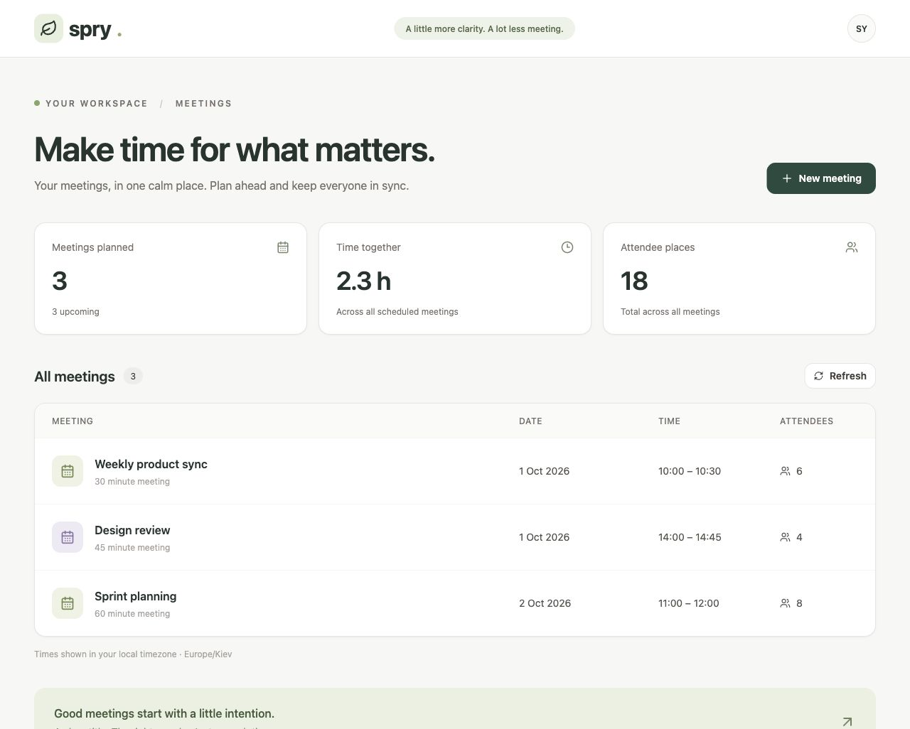

# Spry — meetings workspace

Навчальний monorepo: FastAPI + SQLAlchemy + Alembic, React + Vite + Tailwind та локальні UI-примітиви за підходом shadcn/ui, PostgreSQL, Docker Compose, GitHub Actions і сценарії AWS deploy.

## Онлайн

- Frontend: https://d310vkwtz8a1f0.cloudfront.net
- Backend: https://d310vkwtz8a1f0.cloudfront.net/api/meetings
- Health: https://d310vkwtz8a1f0.cloudfront.net/health
- Вхід (Lab 3, Cognito): https://app.antonyivaso.dynv6.net/login/
- [Успішний AWS deploy](https://github.com/FourShrimp2032/spry/actions/runs/36727682803/attempts/2)



## Запуск

Встановіть і запустіть Docker Desktop. У корені цього проєкту:

```bash
docker compose up --build
```

Наступні запуски: `docker compose up`.

- Frontend: http://localhost:5173
- Backend / OpenAPI: http://localhost:8000/docs
- Список: http://localhost:8000/api/meetings

Додайте зустріч через **New meeting**, оновіть сторінку. Дані зберігаються у PostgreSQL volume. `docker compose down` зупиняє сервіси зі збереженням даних; `docker compose down -v` видаляє локальні дані.

Час у формі — локальний час браузера; API отримує timezone-aware дату, PostgreSQL зберігає момент часу, відповіді API нормалізовано до UTC.

## Документи

- [PROJECT.md](PROJECT.md) — структура й контракт, записані до генерації застосунку.
- [docs/LAB-ANSWERS.md](docs/LAB-ANSWERS.md) — пояснення рішень для захисту.
- [docs/AWS-CLICK-GUIDE.md](docs/AWS-CLICK-GUIDE.md) — покроковий запуск у Safari через CloudShell; починаємо з read-only preflight.
- [docs/AWS.md](docs/AWS.md) — ресурси, HTTPS, OIDC, налаштування й teardown.
- [docs/SUBMISSION.md](docs/SUBMISSION.md) — стан і список матеріалів для здачі.
- [docs/LAB3.md](docs/LAB3.md) — вхід через Cognito (email/пароль і Google): що додано, кроки deploy, що здавати.
- [docs/LAB3-ANSWERS.md](docs/LAB3-ANSWERS.md) — відповіді на питання Lab 3 (міграція, вартість, автентифікація).
- [docs/LAB5.md](docs/LAB5.md) — щотижневий звіт: EventBridge Scheduler → SQS → Lambda → S3 → Lambda → SES.
- [docs/LAB5-ANSWERS.md](docs/LAB5-ANSWERS.md) — відповіді на питання про звіт і event-driven патерн.
- [docs/LAB6.md](docs/LAB6.md) — Paste an agenda: LLM на Amazon Bedrock розбирає вставлений текст у порядок денний.
- [docs/LAB7.md](docs/LAB7.md) — інфраструктура Lab 4–6 перенесена з CloudFormation у Terraform (HCP Terraform), рішення — [ADR 0007](docs/adr/0007-terraform.md).

Стан, зданий у Lab 2, зафіксовано тегом [`lab2`](https://github.com/FourShrimp2032/spry/tree/lab2).

## Перевірки

CI на кожен push та pull request запускає Ruff, ESLint, Prettier, production build та API-тести на PostgreSQL. У backend перевіряються створення, повторне читання, сортування і валідація. Тести навмисно відмовляються очищати базу без суфікса `_test`.

Для запуску поза Docker потрібні Python 3.12.10, Node 22.16.0, npm і окрема PostgreSQL база `spry_test`. Встановіть `backend/requirements-dev.txt`, задайте `DATABASE_URL`, виконайте `alembic upgrade head` у backend, потім `make check` із кореня.

## Deployment

Після налаштування AWS і repository variables із `docs/AWS.md`:

```bash
make deploy-backend
make deploy-frontend
```

CI викликає ті самі команди після успішних перевірок на main.

### Інфраструктура (Terraform)

Вхід (Cognito), щотижневий звіт, parser і budget описані в `infra/*.tf`. State і запуски — у HCP Terraform (організація `ooad-fourshrimp2032`, workspace `spry-dev`): pull request отримує plan як check, merge у `main` — apply. AWS-ключів ніде немає: run бере тимчасові креденшали ролі `hcp-terraform-ooad-fourshrimp2032` через OIDC (`infra/bootstrap`). Базовий stack курсу `spry-lab` лишається CloudFormation, Terraform читає його outputs.

```bash
terraform login        # один раз: токен HCP Terraform
make infra-plan        # speculative plan у HCP Terraform, apply неможливий
make infra-output      # outputs: user pool, queue, bucket, parser URL...
make frontend-env      # публічні значення для збірки сайту -> frontend/.env.production (закомітити)
```

Apply у Makefile немає: будь-яка зміна інфраструктури — це pull request. Секрет Google-клієнта — sensitive змінна workspace, не в Git. Без `AWS_ROLE_ARN` deploy job пропускається — це ще не успішне розгортання. Образи тегуються повним SHA коміту. Міграція — окреме ECS task перед оновленням сервісу.

## Межі цієї роботи

Проєкт базується на клоні https://github.com/dobosevych/OneTwoThree зі збереженою Git-історією. Лабораторна гілка замінює розширений Cognito/Lambda варіант мінімальним Spry відповідно до завдання. GitHub: https://github.com/FourShrimp2032/spry (public). AWS region: eu-north-1. AWS stack `spry-lab` створено, застосунок розгорнуто та перевірено через HTTPS. Готовий `infra/aws-stack.json` створює інфраструктуру через CloudFormation; ресурси платні, створення виконано з дозволу власника акаунта. Окремі JSON-шаблони ролей/task з placeholders — довідкові альтернативи для ручного налаштування. Власного домену поки немає: перший запуск використовує тимчасову CloudFront HTTPS-адресу. Референс Lab 1 відсутній; UI — власне оформлення. Статистика рахується з реальних зустрічей; вигаданих week-over-week відсотків немає.
