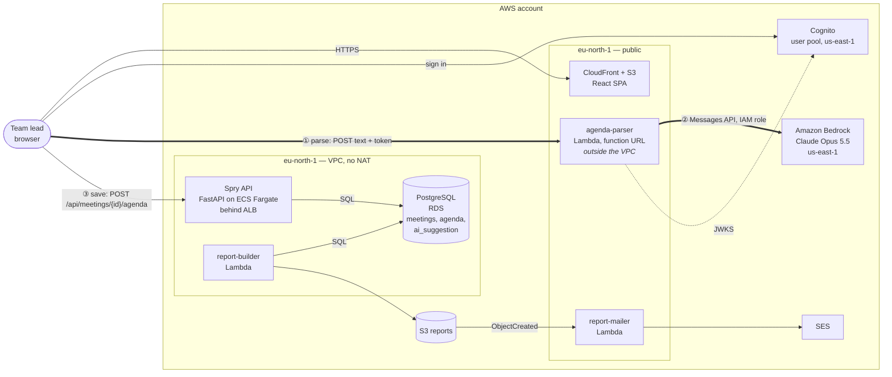

# Spry — containers (C4, level 2)

Updated in Lab 6 with the agenda parser, Bedrock, and the two paths: **parse** (browser → parser → Bedrock) and **save** (browser → API → PostgreSQL).

The parser has no arrow to the database: it receives text and returns JSON. Only the API writes.
